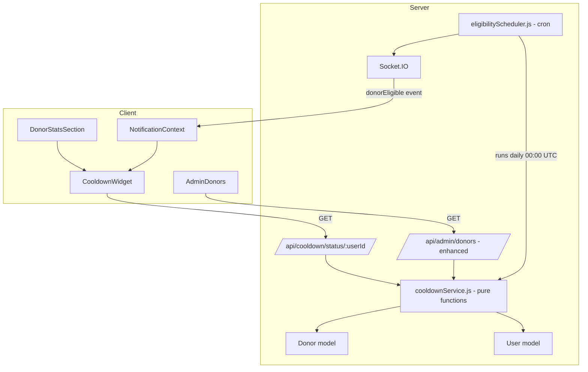

# Design Document: Donation Cooldown Tracker

## Overview

The Donation Cooldown Tracker enforces the 90-day whole-blood donation cooldown rule across BloodConnect. It introduces a pure `cooldownService` on the backend for all cooldown computations, a daily cron scheduler that flips donor availability and emits eligibility notifications via the existing Socket.IO infrastructure, a `CooldownWidget` React component embedded in `DonorStatsSection`, and a cooldown status column with filter controls in `AdminDonors`.

The existing `dashboardRoutes.js` already computes a 42-day recovery window; this feature replaces that with the correct 90-day period and centralises the logic in a dedicated service.

---

## Architecture



**Key design decisions:**

- `cooldownService.js` contains only pure functions (no DB calls, no I/O). This makes it trivially testable and reusable across the route handler, the scheduler, and the admin endpoint.
- The scheduler is a thin orchestrator: it queries eligible donors, calls the pure service to check state, then performs DB writes and Socket.IO emissions.
- The 90-day cooldown period is defined as a single named constant (`COOLDOWN_DAYS = 90`) in `cooldownService.js` — one place to change if medical guidelines update.
- The existing `dashboardRoutes.js` `/stats/:userId` endpoint is updated to use `cooldownService` so the recovery percentage shown in `DonorStatsSection` reflects the correct 90-day window.

---

## Components and Interfaces

### Backend

#### `server/services/cooldownService.js`
Pure functions, no side effects:

```js
// Returns { isEligible, daysRemaining, nextEligibleDate, elapsedDays }
computeCooldownStatus(lastDonationDate: Date | null): CooldownStatus

// Returns true if the donor should receive a notification this scheduler run
shouldNotify(status: CooldownStatus, eligibilityNotifiedAt: Date | null, lastDonationDate: Date | null): boolean
```

#### `server/jobs/eligibilityScheduler.js`
Cron job (node-cron, expression `"0 0 * * *"`):

```js
async function runEligibilityCheck(io): Promise<void>
// Queries all Donor docs, calls computeCooldownStatus, updates availability,
// emits donorEligible via io, updates eligibilityNotifiedAt.
// Errors per-donor are caught and logged; processing continues.
```

#### `server/routes/cooldownRoutes.js`
```
GET /api/cooldown/status/:userId
  → 200 { isEligible, daysRemaining, nextEligibleDate, lastDonationDate }
  → 404 if donor not found
```

#### `server/routes/adminRoutes.js` — enhanced `GET /api/admin/donors`
Each donor object in the response gains two computed fields:
```js
{ ...existingFields, isEligible: boolean, daysRemaining: number }
```

#### `server/routes/donorRoutes.js` — `POST /donate` and `PATCH /approve/:id`
After recording a donation, reset `eligibilityNotifiedAt = null` and set both `Donor.availability = false` and `User.availability = false`.

### Frontend

#### `client/src/components/dashboard/CooldownWidget.jsx`
Props: `{ isEligible, daysRemaining, nextEligibleDate, lastDonationDate, loading }`

States:
- `loading` → renders a skeleton placeholder
- `isEligible = true` → green "You are eligible to donate!" card
- `isEligible = false` → red/amber card with `daysRemaining` countdown and circular progress arc

Mounted inside `DonorStatsSection` after the existing eligibility card, replacing the hardcoded 42-day logic.

#### `client/src/context/NotificationContext.jsx` — new socket listener
```js
socket.on("donorEligible", (payload) => {
  add({
    type: "eligibility",
    title: "🩸 You're Eligible to Donate!",
    body: "Your 90-day cooldown is complete. Schedule your next donation today.",
    link: "/dashboard",
  });
  if (Notification.permission === "granted") {
    new Notification("🩸 You're Eligible to Donate!", { ... });
  }
});
```

#### `client/src/admin/AdminDonors.jsx` — cooldown status column + filter
- New "Cooldown Status" column renders a badge: green "Eligible" or red/amber "In Cooldown (N days)".
- New filter control (dropdown or tab group): "All" | "Eligible" | "In Cooldown" — client-side filter over the already-fetched donor list.

---

## Data Models

### `Donor` model — new field

```js
eligibilityNotifiedAt: {
  type: Date,
  default: null
}
```

No other schema changes are needed. `lastDonationDate`, `donationCount`, and `availability` already exist.

### `User` model — no schema change
`availability` already exists as a Boolean field.

### Cooldown status shape (computed, not persisted)

```ts
interface CooldownStatus {
  isEligible: boolean;       // true when daysRemaining === 0
  daysRemaining: number;     // 0..90
  elapsedDays: number;       // days since lastDonationDate
  nextEligibleDate: Date | null;
}
```

### Socket.IO event payload

```ts
// Server → Client
"donorEligible": { userId: string, donorName: string }
```

---

## Correctness Properties

*A property is a characteristic or behavior that should hold true across all valid executions of a system — essentially, a formal statement about what the system should do. Properties serve as the bridge between human-readable specifications and machine-verifiable correctness guarantees.*

The property-based testing library used is **fast-check** (already compatible with Vitest, which the project uses).

### Property 1: In-cooldown status is correct for all dates within the window

*For any* `lastDonationDate` between 1 and 89 days ago, `computeCooldownStatus` SHALL return `isEligible = false` and `daysRemaining = 90 - elapsedDays`, where `elapsedDays` is the floor of the UTC day difference.

**Validates: Requirements 1.1, 1.3**

### Property 2: Eligible status is correct for all dates at or beyond the window

*For any* `lastDonationDate` that is 90 or more days in the past, `computeCooldownStatus` SHALL return `isEligible = true` and `daysRemaining = 0`.

**Validates: Requirements 1.2, 1.4**

### Property 3: Progress percentage is consistent with daysRemaining

*For any* `daysRemaining` value in [0, 90], the progress percentage displayed by `CooldownWidget` SHALL equal `Math.round((90 - daysRemaining) / 90 * 100)`.

**Validates: Requirements 2.3**

### Property 4: Recording a donation always sets both availability fields to false

*For any* donor (with or without a linked User), recording a donation SHALL result in both `Donor.availability = false` and, where a linked User exists, `User.availability = false`.

**Validates: Requirements 3.1, 3.4**

### Property 5: Scheduler sets availability to true for all expired-cooldown donors

*For any* donor whose `lastDonationDate` is 90 or more days ago and whose `availability` is currently `false`, running the eligibility check SHALL set `Donor.availability = true` (and `User.availability = true` where a linked User exists).

**Validates: Requirements 3.2, 3.4**

### Property 6: Notification idempotency — no duplicate eligibility notifications

*For any* donor where `isEligible = true` and `eligibilityNotifiedAt` is set to a date after `lastDonationDate`, running the scheduler again SHALL NOT emit a `donorEligible` event for that donor.

**Validates: Requirements 4.3, 6.2**

### Property 7: Notification schema conformance

*For any* `donorEligible` socket event received by the client, the notification object added to the store SHALL contain all required fields: `id`, `read`, `ts`, `type`, `title`, `body`.

**Validates: Requirements 4.4**

### Property 8: Admin donor list status rendering matches cooldown state

*For any* donor record with any `lastDonationDate`, the rendered status badge text SHALL be exactly "Eligible" when `isEligible = true`, or match the pattern "In Cooldown (N days)" where N equals `daysRemaining` when `isEligible = false`.

**Validates: Requirements 5.1**

### Property 9: Admin status filter returns only matching donors

*For any* list of donors with mixed eligibility states, applying the "Eligible" filter SHALL return only donors where `isEligible = true`, and applying the "In Cooldown" filter SHALL return only donors where `isEligible = false`.

**Validates: Requirements 5.4, 5.5**

### Property 10: eligibilityNotifiedAt is reset to null on new donation

*For any* donor with a non-null `eligibilityNotifiedAt`, recording a new donation SHALL set `eligibilityNotifiedAt` to `null`.

**Validates: Requirements 6.3**

### Property 11: Scheduler error isolation — one failing donor does not halt others

*For any* list of donors where one donor causes a database error during the scheduler run, all other donors in the list SHALL still be processed (availability updated, notifications emitted as appropriate).

**Validates: Requirements 6.4**

---

## Error Handling

| Scenario | Handling |
|---|---|
| `GET /api/cooldown/status/:userId` — donor not found | 404 `{ message: "Donor not found" }` |
| `GET /api/cooldown/status/:userId` — invalid ObjectId | 400 `{ message: "Invalid userId" }` |
| Scheduler DB error for a single donor | `console.error` with donor ID; continue loop |
| Scheduler: linked User not found | `console.warn` with donor ID; update only `Donor.availability` |
| `CooldownWidget` fetch failure | Display last known state or a neutral "Status unavailable" message; do not crash |
| Socket.IO disconnected when `donorEligible` fires | Event is not delivered; donor will see updated status on next dashboard load via REST |
| `eligibilityNotifiedAt` write fails after notification emitted | Notification may be re-sent on next scheduler run (acceptable; not a data-loss scenario) |

---

## Testing Strategy

### Unit tests (Vitest, server)

- `cooldownService.test.js` — example-based tests for the null `lastDonationDate` case (Requirement 1.5), the exact 90-day boundary, and the donor-without-linked-user path (Requirement 3.5).
- `eligibilityScheduler.test.js` — mock DB and Socket.IO; verify cron expression, verify no emission when `eligibilityNotifiedAt` is already set.

### Property-based tests (Vitest + fast-check, server)

Each property test runs a minimum of 100 iterations.

| Test file | Properties covered |
|---|---|
| `cooldownService.property.test.js` | Properties 1, 2, 10 |
| `eligibilityScheduler.property.test.js` | Properties 5, 6, 11 |
| `donorDonation.property.test.js` | Property 4 |

Tag format used in each test:
```js
// Feature: donation-cooldown-tracker, Property N: <property text>
```

### Unit tests (Vitest + @testing-library/react, client)

- `CooldownWidget.test.jsx` — example-based: loading skeleton, eligible state, in-cooldown state, null lastDonationDate.
- `AdminDonors.test.jsx` — example-based: green badge for eligible, red badge for in-cooldown, filter controls present.
- `NotificationContext.test.jsx` — example-based: `donorEligible` event adds correct notification, browser Notification called when permission granted.

### Property-based tests (Vitest + fast-check, client)

| Test file | Properties covered |
|---|---|
| `CooldownWidget.property.test.jsx` | Property 3 |
| `AdminDonors.property.test.jsx` | Properties 8, 9 |
| `NotificationContext.property.test.jsx` | Property 7 |

### Integration tests (Vitest + Supertest + mongodb-memory-server)

- `cooldownRoutes.integration.test.js` — covers Requirement 1.6: three scenarios (no donation, in cooldown, eligible), verify response shape.
- `adminDonors.integration.test.js` — covers Requirement 5.6: verify `isEligible` and `daysRemaining` fields present in response.
- `eligibilityScheduler.integration.test.js` — covers Requirement 4.1: mock Socket.IO, seed eligible donors, run scheduler, verify `donorEligible` emitted.

### Smoke test

- `schedulerConfig.smoke.test.js` — verify the cron expression string equals `"0 0 * * *"` (Requirement 3.3).
