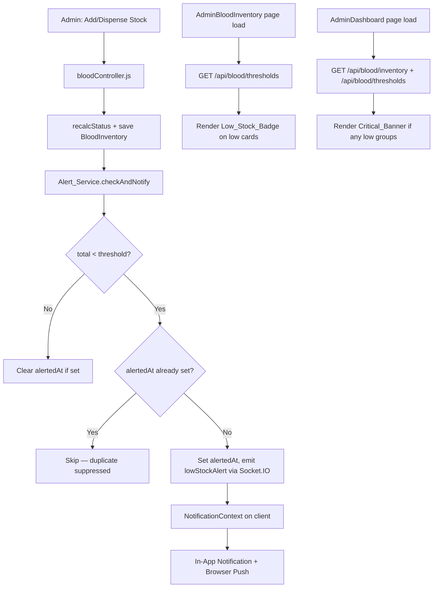

# Design Document: Inventory Low-Stock Alerts

## Overview

This feature adds proactive low-stock alerting to BloodConnect's blood bank management system. When any blood group's total inventory falls below a configurable per-group threshold, the system emits a real-time Socket.IO notification, displays a visual badge on the AdminBloodInventory page, and shows a summary banner on the AdminDashboard. Duplicate alerts are suppressed by tracking an `alertedAt` timestamp per blood group — the alert fires once per continuous low-stock period and resets when stock recovers.

The feature integrates with the existing `BloodInventory` model, `bloodController.js` stock-modification logic, Socket.IO infrastructure (`app.set("io", io)`), and the frontend `NotificationContext`.

---

## Architecture



**Key design decisions:**

- The `Threshold_Model` is a new, lightweight MongoDB collection — one document per blood group — storing `threshold` (default 10) and `alertedAt` (nullable timestamp). This keeps threshold state co-located with alert suppression state.
- Alert detection runs synchronously inside the existing `addStock` / `dispenseStock` controller functions, using the already-retrieved `io` instance from `req.app.get("io")`. No new background job or polling is needed.
- The frontend fetches thresholds independently from inventory so the badge/banner logic is decoupled from the existing inventory fetch.

---

## Components and Interfaces

### Backend

#### `Threshold_Model` (`server/models/StockThreshold.js`)
New Mongoose model. One document per blood group.

#### `Alert_Service` (`server/services/alertService.js`)
Pure async function `checkAndNotify(bloodType, total, io)` — evaluates threshold, handles suppression, emits event.

#### `thresholdController.js` (`server/controllers/thresholdController.js`)
- `getThresholds(req, res)` — returns all 8 blood group thresholds
- `updateThreshold(req, res)` — validates and persists a threshold update

#### `bloodRoutes.js` additions
```
GET  /api/blood/thresholds          → getThresholds
PATCH /api/blood/thresholds/:bloodGroup → updateThreshold
```

#### `bloodController.js` modifications
After `inventory.save()` in both `addStock` and `dispenseStock`, call:
```js
await checkAndNotify(bloodType, total, req.app.get("io"));
```

### Frontend

#### `NotificationContext.jsx` modification
Add a `lowStockAlert` socket listener that calls `add()` with `type: "low_stock"`.

#### `AdminBloodInventory.jsx` modification
- Fetch thresholds on mount alongside inventory.
- Compute `isLowStock(item)` = `total < threshold[item.bloodType]`.
- Render `<LowStockBadge units={total} />` on low-stock cards.

#### `AdminDashboard.jsx` modification
- Fetch inventory + thresholds on mount.
- Derive `lowStockGroups` array.
- Render `<CriticalBanner groups={lowStockGroups} />` when non-empty.

---

## Data Models

### `StockThreshold` (new)

```js
{
  bloodGroup: String,   // "A+", "A-", "B+", "B-", "O+", "O-", "AB+", "AB-"
  threshold:  Number,   // default: 10, min: 0
  alertedAt:  Date,     // null = no active low-stock period; set = alert already sent
}
```

Index: `{ bloodGroup: 1 }` unique.

**Default seeding:** On first `getThresholds` call, if fewer than 8 documents exist, the service upserts defaults for all 8 standard blood groups.

### `BloodInventory` (existing — no schema changes)

The `status` field ("Critical" / "Low" / "Adequate") continues to be computed by `recalcStatus()` using fixed thresholds (50 / 100). The new `Threshold_Model` operates independently with configurable per-group thresholds.

### Socket.IO event: `lowStockAlert`

```json
{
  "bloodGroup":    "O-",
  "currentUnits":  7,
  "threshold":     10,
  "timestamp":     "2025-01-15T10:30:00.000Z"
}
```

---

## Correctness Properties

*A property is a characteristic or behavior that should hold true across all valid executions of a system — essentially, a formal statement about what the system should do. Properties serve as the bridge between human-readable specifications and machine-verifiable correctness guarantees.*

### Property 1: Total units computation is the sum of all four components

*For any* four non-negative integers representing wholeBlood, plasma, platelets, and rbc, the total units value computed by the Alert_Service SHALL equal their arithmetic sum.

**Validates: Requirements 2.1**

---

### Property 2: Low-stock classification matches threshold comparison

*For any* blood group with a configured threshold T and computed total units U, the Alert_Service SHALL classify the blood group as low-stock if and only if `U < T`, and as adequate if and only if `U >= T`.

**Validates: Requirements 2.2**

---

### Property 3: Exactly one alert per continuous low-stock period

*For any* sequence of stock-modifying operations that keeps a blood group's total units continuously below its threshold, the Alert_Service SHALL emit exactly one `lowStockAlert` event. For any sequence containing N distinct low-stock periods (separated by recoveries), the Alert_Service SHALL emit exactly N `lowStockAlert` events.

**Validates: Requirements 2.3, 3.6, 6.2, 6.4**

---

### Property 4: alertedAt is cleared on stock recovery

*For any* blood group whose `alertedAt` is set (indicating an active low-stock period), when a stock-modifying operation brings total units to at-or-above the threshold, the `alertedAt` field SHALL be set to null, enabling a future alert if stock drops below the threshold again.

**Validates: Requirements 2.4, 6.3**

---

### Property 5: Threshold validation rejects all non-non-negative-integer values

*For any* threshold update request where the submitted value is not a non-negative integer (including negative numbers, floating-point numbers, strings, and null), the API SHALL return a 400 error and the stored threshold for that blood group SHALL remain unchanged.

**Validates: Requirements 1.3**

---

### Property 6: Threshold GET always returns all 8 blood groups with valid defaults

*For any* state of the Threshold_Model (including empty), a GET request to `/api/blood/thresholds` SHALL return exactly 8 entries — one for each of A+, A-, B+, B-, O+, O-, AB+, AB- — where any blood group without an explicit saved threshold returns the default value of 10.

**Validates: Requirements 1.1, 1.4**

---

### Property 7: Low-stock badge visibility matches threshold comparison

*For any* rendered AdminBloodInventory page given a set of inventory items and thresholds, a blood group card SHALL display a Low_Stock_Badge if and only if its total units are strictly less than its configured threshold, and SHALL NOT display a badge otherwise.

**Validates: Requirements 4.1, 4.3**

---

### Property 8: lowStockAlert payload contains all required fields with correct types

*For any* low-stock event on any blood group, the emitted `lowStockAlert` Socket.IO payload SHALL contain all four required fields: `bloodGroup` (string), `currentUnits` (number), `threshold` (number), and `timestamp` (valid ISO 8601 string).

**Validates: Requirements 3.2**

---

### Property 9: Critical_Banner renders iff low-stock groups exist and lists all of them

*For any* combination of inventory and threshold data, the AdminDashboard SHALL display the Critical_Banner if and only if at least one blood group has total units below its threshold. When displayed, the banner SHALL include the blood group name and current unit count for every low-stock blood group — no more, no fewer.

**Validates: Requirements 5.1, 5.2, 5.3**

---

## Error Handling

| Scenario | Handling |
|---|---|
| `threshold` value is negative or non-integer | `thresholdController` returns `400` with message `"Threshold must be a non-negative integer"` |
| `bloodGroup` in PATCH not one of the 8 standard groups | `400` with message `"Invalid blood group"` |
| `StockThreshold` DB write fails during `checkAndNotify` | Log error, do not throw — stock operation already succeeded; alert is best-effort |
| Socket.IO `io` is unavailable in controller | Guard with `if (io)` before emitting; log warning |
| Frontend threshold fetch fails | Fall back to default threshold of 10 for all groups; log warning |
| `lowStockAlert` socket event received with malformed payload | NotificationContext validates required fields before calling `add()`; silently drops malformed events |

---

## Testing Strategy

### Unit Tests (Vitest — server)

- `alertService.checkAndNotify`: test the pure detection + suppression logic with an in-memory MongoDB (mongodb-memory-server, already a dev dependency).
  - Stock drops below threshold → alert emitted, `alertedAt` set.
  - Stock stays below threshold on second call → no second emit.
  - Stock recovers → `alertedAt` cleared.
  - Stock drops again after recovery → new alert emitted.
- `thresholdController.getThresholds`: returns 8 groups with defaults.
- `thresholdController.updateThreshold`: accepts valid values, rejects invalid ones.

### Property-Based Tests (Vitest — server)

The project uses Vitest. For property-based testing, **fast-check** will be used (pure JS, no extra runtime needed).

Install: `npm install --save-dev fast-check` in `server/`.

Each property test runs a minimum of **100 iterations**.

Tag format: `// Feature: inventory-low-stock-alerts, Property N: <text>`

- **Property 1** — `fc.tuple(fc.nat(), fc.nat(), fc.nat(), fc.nat())` for (wholeBlood, plasma, platelets, rbc) → verify computed total equals their sum.
- **Property 2** — `fc.tuple(fc.nat(), fc.nat())` for (total, threshold) → verify low-stock classification matches `total < threshold`.
- **Property 3** — `fc.array(fc.nat({ max: threshold - 1 }), { minLength: 1 })` for sequences of stock values all below threshold → verify emit count is exactly 1.
- **Property 4** — Generate a low-stock state then a recovery value ≥ threshold → verify `alertedAt` is null after recovery.
- **Property 5** — `fc.oneof(fc.double({ noNaN: true, noDefaultInfinity: true }).filter(n => !Number.isInteger(n) || n < 0), fc.string())` → verify all rejected with 400 and stored threshold unchanged.
- **Property 6** — Vary which blood groups have saved thresholds (any subset of the 8) → verify GET always returns exactly 8 entries, unconfigured ones return 10.
- **Property 7** — `fc.tuple(fc.nat(), fc.nat())` for (units, threshold) → render badge component; verify badge present iff `units < threshold`.
- **Property 8** — Generate various (bloodGroup, currentUnits, threshold) inputs → verify emitted payload always contains all four fields with correct types.
- **Property 9** — `fc.array(fc.record({ bloodGroup: fc.constantFrom(...BLOOD_GROUPS), total: fc.nat(), threshold: fc.nat() }))` → render AdminDashboard; verify banner present iff any `total < threshold`, and banner lists exactly those groups.

### Integration Tests

- `POST /api/blood/inventory/add` with stock that crosses the threshold → verify `lowStockAlert` is emitted on the socket.
- `PATCH /api/blood/thresholds/:bloodGroup` → verify persistence.
- Full round-trip: add stock (low) → alert fires → add more stock (recovery) → `alertedAt` cleared → add stock (low again) → second alert fires.

### Frontend Tests (React Testing Library)

- `AdminBloodInventory`: mock threshold + inventory API responses; assert badge renders on low-stock cards and is absent on adequate cards.
- `AdminDashboard`: mock low-stock data; assert `CriticalBanner` renders with correct blood groups and link.
- `NotificationContext`: simulate `lowStockAlert` socket event; assert notification is added with correct type and link.
